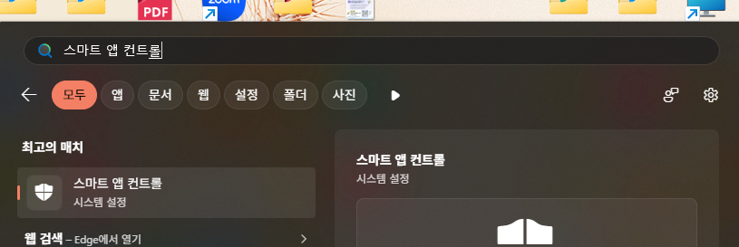
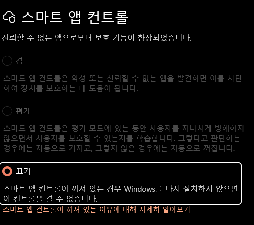
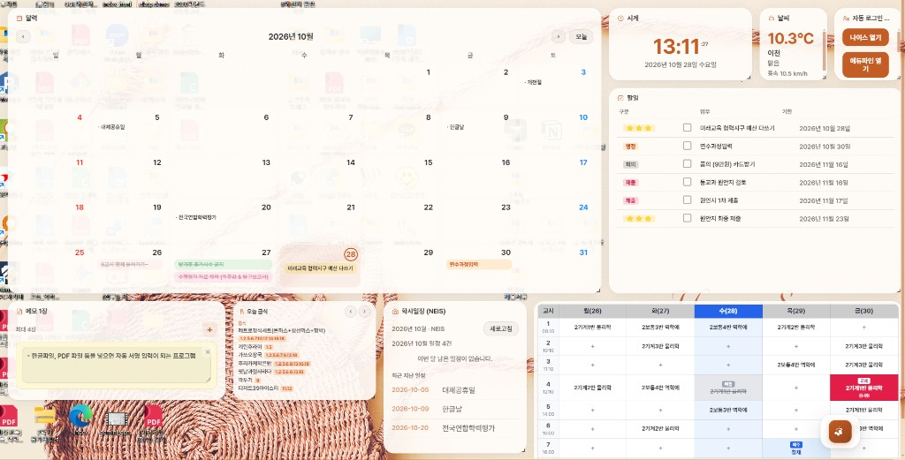

# SchoolUtil — 시작 가이드

바탕화면 한곳에서 **시간표 · 급식 · 할 일 · 학사일정**을 모아 보는 작은 도구예요.  
처음 한 번 **학교만 연결**해 두면 급식·학사일정이 알아서 따라옵니다. (대략 **3~5분**)

> 예시는 **이천제일고** 기준입니다. 다른 학교도 «학교 검색»만 바꾸면 같은 방식이에요.

---

## 설치 전에 — 스마트 앱 컨트롤 끄기 (Windows 11)

SchoolUtil 설치 파일은 **Microsoft 서명이 없어서**, PC에 **스마트 앱 컨트롤**이 켜져 있으면 설치·실행이 막히는 경우가 있어요. **설치가 안 되거나 exe가 바로 닫히면** 아래를 먼저 해 보세요.

검색 메뉴에 «스마트 앱 컨트롤»이 **아예 없으면** 이 PC에는 해당 기능이 없는 Windows일 수 있어요. 그때는 아래 **1. 설치**의 SmartScreen «추가 정보 → 실행»만 하면 됩니다.

### 따라 하기

1. **Windows 키** → 검색창에 `스마트 앱 컨트롤` 입력  
2. **«최고의 매치» → 스마트 앱 컨트롤 (시스템 설정)** 열기  
3. **«끄기»** 선택 후 저장  
4. 다시 `SchoolUtil-Setup-x.x.x.exe` 설치  

**주의:** «끄기»로 바꾼 뒤에는 Windows를 **다시 설치하지 않으면** 스마트 앱 컨트롤을 **다시 켤 수 없다**는 Windows 안내가 있습니다. 학교 PC면 IT 담당 선생님께 여쭤 보세요.

---

## 1. 설치

1. `SchoolUtil-Setup-x.x.x.exe` 실행  
2. SmartScreen이 뜨면 **추가 정보 → 실행** (그래도 안 되면 위 **스마트 앱 컨트롤** 안내 확인)  
3. 설치 후 SchoolUtil 실행  

**알아두면 좋아요**

- 창 **X** = 종료가 아니라 **트레이로 숨기기** (완전 종료는 트레이 → 종료)
- 설정·할 일 등은 `%APPDATA%\SchoolUtil\` 에 저장돼요
- 이 설명서는 설치 폴더 **`docs`** 에도 같이 들어 있어요

---

## 2. 화면은 이렇게 생겼어요

**이천제일고** 연동 후 예시:

**달력 × 할 일** — 마감일 있는 할 일은 달력 칸에 같이 보이고, 날짜를 누르면 그날 **학사일정 + 할 일**을 한곳에서 추가·완료할 수 있어요.

**설정 여는 곳:** 화면 **맨 아래 톱니바퀴** (또는 제목줄 설정)

---

## 3. 카드별로 이렇게 써요

| 카드 | 한 줄 소개 |
|------|------------|
| **달력** | NEIS 학사일정 + 할 일(마감일)을 한 달에 표시 · 날짜 클릭으로 그날 정리 |
| **할 일** | 구분·업무·기한 표 · 체크로 완료 · 비어 있으면 달력에서 추가 |
| **급식** | 오늘 NEIS 급식 (학교 연동 필요) |
| **학사일정** | 이번 달·오늘 NEIS 일정 목록 |
| **시계** | 현재 시각·요일 |
| **날씨** | Open-Meteo · 지역·좌표는 설정 → 학교 연동 |
| **시간표** | 수동 입력 또는 컴시간 · 교체 수업·(+) 보정 |
| **메모** | 포스트잇 여러 장 · 자동 저장 |
| **D-Day** | 시험·행사까지 D-n / D-Day |
| **업무포털** | 나이스·에듀파인 등 바로 열기 (선택) |

### 제일 메이트 (아침 요약)

앱을 켤 때 **하루 한 번** 짧게 모아 보여줘요.

- **오늘 마감 할 일**, **오늘 시간표**, **급식**, **오늘 일정** 등 (항목은 설정에서 고름)
- 설정 → **카드** → «제일 메이트» · 글자 크기 · 미리 보기

---

## 4. 학교 연결 — **필수**

급식·학사일정·달력 학사일정을 쓰려면 꼭 필요해요. 보통 **API 키 없이 학교 검색**만 하면 됩니다.

### 이천제일고 따라 하기

1. 설정 → **학교 연동**  
2. **학교 검색**에 `이천제일고` → 목록에서 학교 선택 (코드 자동 입력)  
3. 날씨 지역 이름 `이천` (선택이지만 추천)  
4. **설정 저장** ← 잊지 마세요  
5. 설정 → **카드**에서 급식·학사일정·달력 켜기  

**성공 확인:** 급식에 메뉴가 보이거나, 학사일정·달력에 학교 일정이 보이면 OK.

**안 보일 때:** 설정 저장 눌렀는지, 학교를 다시 검색·선택했는지 확인.

---

## 5. 컴시간 시간표 — **이천제일고면 꼭**

NEIS랑 **컴시간 학교 코드는 달라요.** 같은 «학교 연동» 탭 아래에서 설정합니다.

1. **컴시간 학교 검색** → `이천제일` → 이천제일고등학교 선택  
2. **학급 이름 표기** → **제일고 ver** (일반고 ver 아님!)  
3. **교사 선택** (이름이 `*`로 가려져 있어도 정상)  
4. **자동 갱신** 켜기 + **지금 가져오기**  
5. **설정 저장** → 카드에서 시간표 켜기  

컴시간 접속이 안 되면 «s2h9 프록시» 모드를 시도해 볼 수 있어요 (학교마다 다름).

---

## 6. 업무포털 · 자동 로그인 — **선택**

안 써도 앱은 그대로 잘 돌아가요.

### 처음엔 이렇게 (추천)

- 설정 → **포털** → **URL만 열기**  
- 교육청 **경기** · 쓰는 포털 «카드에 표시» · **설정 저장**  
- 버튼 누르면 브라우저 열림 → 인증서는 평소처럼 직접 로그인  

### 자동 로그인 (실험)

- «자동 로그인 시도» + Chrome/Edge/Whale + 인증서 정보 저장  
- **테스트해 보기**로 확인 · 안 되면 URL만 열기로 되돌리기  
- (선택) Brity 메신저 · OS 인증서 창 자동 입력 — 포털 탭 안내 참고  
- 비밀번호는 `schoolutil-secrets.json`에만 저장 (백업 JSON에는 없음)

---

## 7. 꾸미기 · 배치 · 저장

| 무엇 | 어디서 | 뭐가 되나요 |
|------|--------|-------------|
| **테마** | 설정 → 테마 | 밝기·글꼴·카드 투명도·밀도 |
| **카드** | 설정 → 카드 | 카드 on/off · **레이아웃 프리셋**(벤토, 달력 중심, 시간표 중심, 간결, 와이드 등) |
| **배치** | 대시보드 | 카드 **드래그**로 위치·크기 조절 |
| **표시** | 설정 → 표시 | **위젯 모드**(바탕화면) / 일반 창 · Windows 시작 시 실행 · 모니터·화면 맞춤 |
| **백업** | 설정 → 백업 | JSON **보내기/불러오기** · 자동 백업 · **업데이트 확인**(설치판) |

**설정 탭 요약:** 테마 · 카드 · 표시 · 학교 연동 · 백업 · 포털 · 안내(단축키)

---

## 8. 자주 쓰는 것

| | |
|---|---|
| `Ctrl+Alt+D` | 위젯 숨기기 / 다시 앞에 |
| `Ctrl+Alt+Shift+D` | 바탕화면 모드 탈출 |
| 트레이 더블 클릭 | 다시 앞에 보기 |

---

**도움:** [GitHub — SchoolUtil](https://github.com/wogud32215-dev/SchoolUtil)
